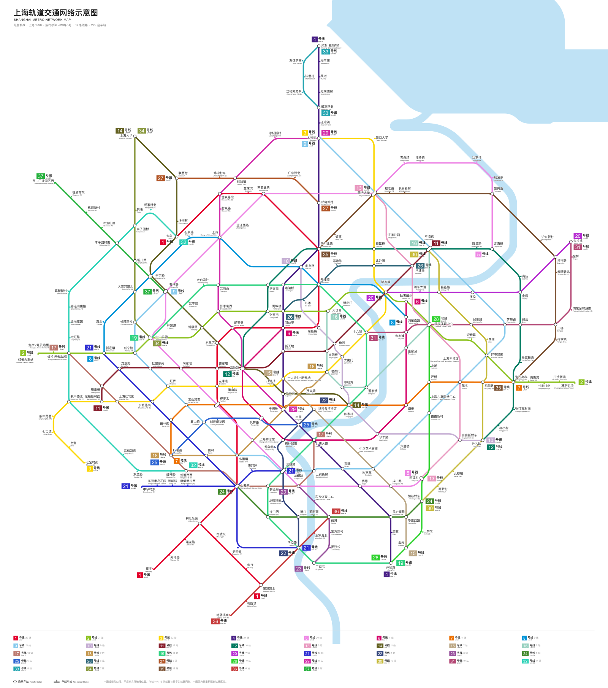
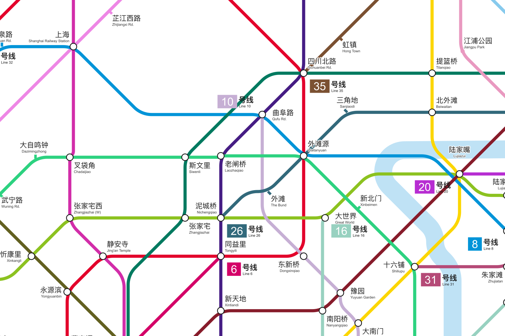

# citymetro-schematic

把《城市与地铁》的存档画成官方风格的地铁线路示意图：线路只走横、竖和 45°，转弯是圆角，
共线区段并排画开，每条线有「N 号线 / Line N」标牌，站名附英文，江河湖海拉直后作为底图。

游戏自带的线路图按真实地理画，线路一密就挤成一团。这个工具重新排版整张网络，适合截图分享。



局部（原图 4200 px 宽）：



## 安装

需要 Python 3.10 及以上。

```sh
git clone https://github.com/qqqqqf-q/citymetro-schematic.git
cd citymetro-schematic
python -m venv .venv && source .venv/bin/activate
pip install .
```

输出 PNG 还需要 `rsvg-convert`（macOS：`brew install librsvg`；Debian/Ubuntu：`apt install librsvg2-bin`）。
没有它也能用，只输出 SVG，用浏览器打开即可。

## 使用

在游戏里导出存档（`.cmsave.json`），然后：

```sh
citymetro-schematic "城市与地铁_某存档.cmsave.json"
```

在存档旁边生成同名的 `.svg` 和 `.png`。300 座车站左右的网络大约需要一分钟。

常用选项：

| 选项 | 作用 |
| --- | --- |
| `-o 图.png` | 指定输出位置，`.svg` 或 `.png` |
| `--title 标题` | 自定义中文标题，默认「<城市>轨道交通网络示意图」 |
| `--names 译名.json` | 覆盖英文站名，格式 `{"中文站名": "English Name"}` |
| `--center 站名` | 指定市中心车站。默认取地图预设，没有预设时取车站最密的区域 |
| `--fisheye 0.5` | 市中心放大程度。0 按原比例，越大中心越疏、郊区越紧 |
| `--simplify 0.8` | 越大线路转折越少，但离原来的走向越远 |

完整列表见 `citymetro-schematic --help`。

## 原理

1. **初步排版**：以地理位置为起点，用最小二乘迭代把每段线路拉向最近的八方向，同时推开挤在一起的车站。
   市中心按鱼眼放大，郊区压缩。
2. **拉直**：把每条线切成几段近似直线的链，为每段选好方向，再用线性规划求坐标，
   保证每条边严格水平、垂直或 45°，且总长度最短。解不出的边退化为带一个转折的折线；
   车站重叠、线压车站等冲突在下一轮作为约束补上，直到没有冲突。
3. **绘制**：转弯处画圆弧，弯得越急半径越小；多条线共用的轨道按固定间距并排画开；
   标签和标牌逐个找不压线、不压站的位置。水系取自存档的土地利用图层：
   宽阔水面按轮廓填色，河流取中心线画成等宽色带，再随车站一起变形，并拉直成八方向。

## 已知限制

- 英文站名按拼音和后缀规则生成（路 → Rd.，公园 → Park，末尾的东/西/南/北 → (E)/(W)/(S)/(N)），
  地标类站名需要手动翻译。可以用 `--names` 覆盖，也欢迎为你的地图补一份 `citymetro_schematic/maps/<地图 id>.json`
  （地图 id 见存档 `meta.map`，格式参照 `maps/sh.json`）。
- 线路特别密的市中心，少数标签会贴近线路，个别线路会从不停靠的车站旁边经过。
- 远离车站的水面位置是外推出来的，形状只是示意。
- 目前只在上海地图的存档上调过参数，其他地图欢迎反馈效果。
- 存档格式是从游戏导出文件中观察得来的，游戏更新后可能失效。

## 许可

MIT
